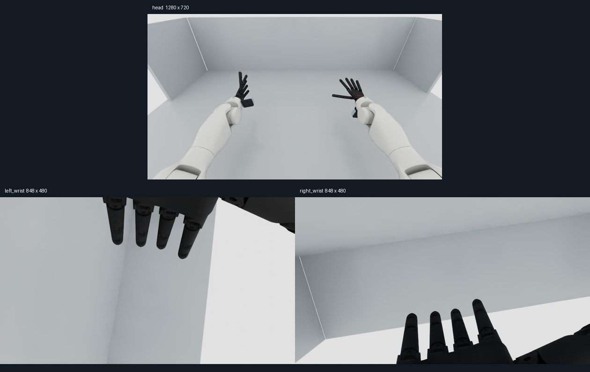

# PI05 Isaac Sim 仿真场景

在 Isaac Sim 6.0 中使用 **File → Open** 打开同目录的 `workspace_pi05.usda`。如果出现 **ScriptNode Warning**，在当前会话授权后点 **Play**。内嵌 Action Graph 会启用重力补偿和阻尼，无需运行独立控制脚本。

场景包含天机双臂、舞肌双手、相机、桌面和三面围挡。右臂初始角度取自 53 段原始 LeRobot 录制首帧的逐关节中位数，左臂按机器人左右对称面镜像。手指采用模型的初始姿态。

## 场景文件

下表列出 7 个主场景图层。查看苹果抓放场景时打开 [`workspace_pi05_pick_place.usda`](workspace_pi05_pick_place.usda)，查看三路相机时也可打开 [`workspace_pi05_cameras.usda`](workspace_pi05_cameras.usda)。主场景入口会自动载入表格中位于其下方的图层。

| 文件 | 用途 |
| --- | --- |
| [`workspace_pi05_pick_place.usda`](workspace_pi05_pick_place.usda) | 在带相机的场景中加入红苹果、绿盘和起抓垫块。 |
| [`workspace_pi05_cameras.usda`](workspace_pi05_cameras.usda) | 加载完整仿真并附加头部、左腕和右腕的 RGB 相机。 |
| [`workspace_pi05.usda`](workspace_pi05.usda) | 场景入口。内嵌 Action Graph，播放时启用重力补偿和阻尼。 |
| [`workspace_pi05_impedance.usda`](workspace_pi05_impedance.usda) | 定义 PI05 对应的关节刚度与末端负载质量和质心。 |
| [`workspace_measured_arms.usda`](workspace_measured_arms.usda) | 保存录制推导出的双臂初始关节角、驱动目标和对应的连杆姿态。 |
| [`workspace_factory_robot.usda`](workspace_factory_robot.usda) | 装配舞肌双手，定义机械臂的质量、惯量、关节限位和碰撞形状。 |
| [`workspace_appearance.usda`](workspace_appearance.usda) | 定义场景材质，并载入机器人、桌面和围挡的基础场景。 |

基础场景保存在 [`robot_workspace_wall_aligned_full_column.usdc`](robot_workspace_wall_aligned_full_column.usdc)。双手装配引用 `official_wuji/` 里的模型。移动或复制场景时请保留整个目录结构，图层和模型通过相对路径引用。

## RGB 相机预览

打开相机场景后，从视口的 **Perspective** 菜单选择头部或腕部相机。头部相机固定在机架上，双腕相机随各自的末端连杆运动。光心和朝向来自安装关系，焦距、主点和畸变参数来自 [ROS 驱动的 CameraInfo](camera_rgb_driver_info.json)。

右手和右腕相机组件绕右腕 TCP 的 Z 轴转回了 90°，安装位置与左侧近似镜像。

下图为双臂初始姿态下的仿真画面。头部原图为 1280×720，双腕原图均为 848×480。[头部](camera_preview/head.png) · [左腕](camera_preview/left_wrist.png) · [右腕](camera_preview/right_wrist.png)



三路相机都使用 4 cm 的近裁剪距离，以避开 CAD 相机外壳造成的遮挡。光心前 4 cm 内的物体会被裁掉。

## 控制与来源

右臂使用 PI05 部署的刚度、阻尼比例和末端质量与质心。左臂使用同样的阻抗比例及左臂自己的负载配置。阻尼根据初始姿态下的各关节惯量近似计算，末端惯量采用等效质量近似。场景仅执行仿真控制，不连接实机或运行策略推理。

`build_pi05_scene.py` 使用当前装配与初始位图层生成两个 PI05 USD 图层，并将 `pi05_graph_controller.py` 的源码嵌入场景入口。舞肌手模型来自 [Wuji Technology](https://github.com/wuji-technology/wuji-description/tree/4feaeb69bac8e06325b090abfbb3d784a5a9194a)，授权文件位于 `official_wuji/LICENSE`。

## 在仿真中运行 PI05

`run_pi05_sim.py` 打开带相机的场景，从头部和右腕获取 RGB，并以弧度读取右臂 7 轴、右手 20 轴。它通过本机 WebSocket 调用现有 PI05 权重，将返回的绝对角度目标写给 PhysX。场景内的重力补偿和阻尼继续生效。左臂和左手沿用场景的驱动目标。

Casbot 上直接启动只提供推理的服务。从本仓库目录运行下列命令。如果已经安装客户端依赖，可跳过 pip 命令。

```bash
systemctl --user start wuji-pi05
ISAAC_SIM_ROOT="$HOME/isaacsim-6.0.0"
OPENPI_ROOT="$HOME/wuji-openpi"
PI05_DEPS="$HOME/.local/share/tianji-wuji-sim/python"
env -u PYTHONPATH -u LD_LIBRARY_PATH -u CONDA_PREFIX \
  "$ISAAC_SIM_ROOT/python.sh" -m pip install --target "$PI05_DEPS" "msgpack==1.1.2"
env -u LD_LIBRARY_PATH -u CONDA_PREFIX \
  PYTHONPATH="$PI05_DEPS:$OPENPI_ROOT/packages/openpi-client/src" \
  "$ISAAC_SIM_ROOT/python.sh" run_pi05_sim.py
```

默认只执行一次推理并检查动作形状。把最后一行改成 `"$ISAAC_SIM_ROOT/python.sh" run_pi05_sim.py --gui --steps 150` 可从第三视角观看 5 秒仿真动作。默认每执行 20 帧重新取图和推理，等待期间仿真时间停止推进，结束后窗口停在最后一帧。该入口使用逐批推理，实机程序的 RTC 动作拼接未接入。

在窗口里的 **PI05 Runner** 面板点击 **Run again**，会重新读取场景文件，将机器人和物品恢复到初始状态，再在同一个 Isaac Sim 窗口执行一轮。连续试验期间请保留 PI05 推理服务。

### 抓放物品

以 LeRobot 录制 `20261118_164904_948090` 的首帧为初始摆放参考，用头部相机内参与安装关系反投影到 0.75 m 高的桌面。绿盘尺寸也与另外 17 张盘沿清晰的录制首帧交叉核对。

| 物品 | 仿真尺寸 | 物理设置 |
| --- | --- | --- |
| 红苹果 | 宽 8.6 cm，高 7.9 cm | 可抓取刚体，按轻质塑料暂估 30 g，静摩擦系数 1.0，动摩擦系数 0.8 |
| 绿盘 | 外径 25.6 cm，盘沿高 1.2 cm | 固定，保留凹形内面和盘沿碰撞 |
| 黑色垫块 | 宽 13.7 cm，深 19.2 cm，高 6.5 cm | 固定，苹果从垫块上开始 |

### 拇指软垫

抓放场景加载 [`workspace_wuji_thumb_pads.usda`](workspace_wuji_thumb_pads.usda)。该图层把官方一代软垫版的左右拇指软垫固定到现有手模型的拇指第二节，保留源资产的三角网格、质量（每侧约 8.55 g）、惯量和碰撞过滤关系。来源为 [舞肌官方一代软垫 USD](https://github.com/wuji-technology/wuji-description/tree/4feaeb69bac8e06325b090abfbb3d784a5a9194a/hand/body-with-soft/usd)，网格和同目录的授权文件位于 `official_wuji/`。

软垫碰撞网格使用 PhysX 柔顺接触。当前试验参数为静摩擦 1.0、动摩擦 0.8、接触刚度 2000 N/m、接触阻尼 15 N·s/m，均为仿真估值。刚度按 1 N 作用力对应约 0.5 mm 的压缩量取初值。柔顺性由接触求解器近似，软垫网格保持固定形状。
